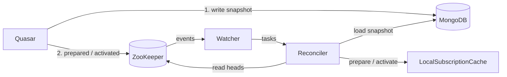
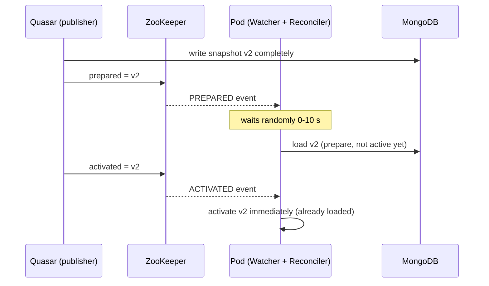
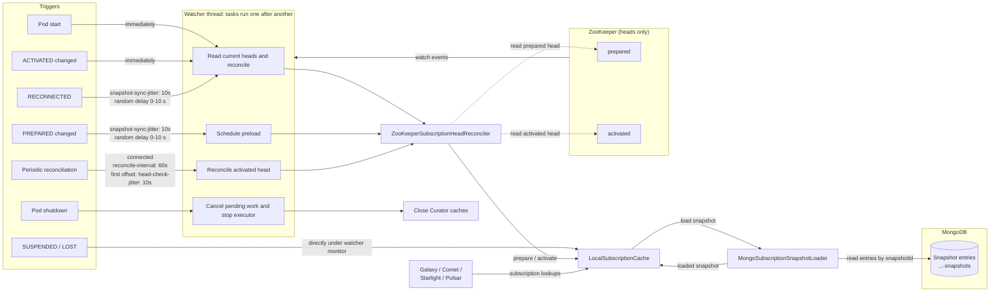
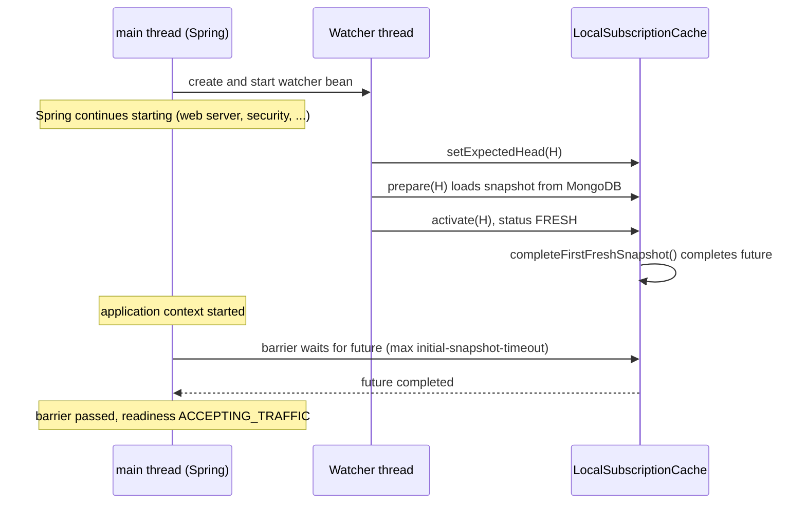
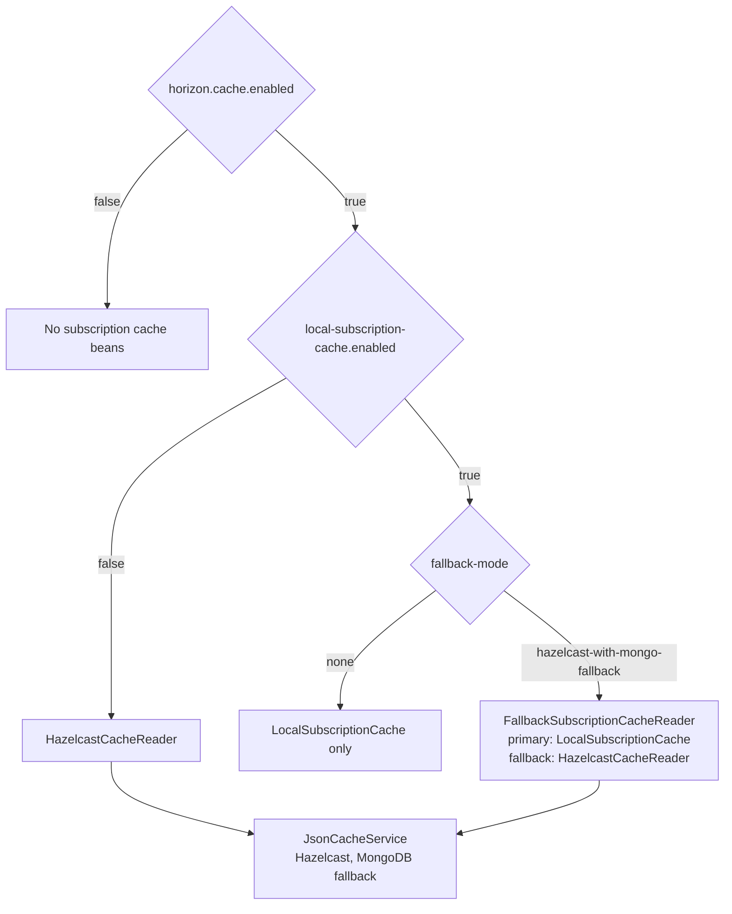

<!--
Copyright 2026 Deutsche Telekom AG

SPDX-License-Identifier: Apache-2.0
-->

# Local Subscription Cache

Developer overview and reference for the pod-local subscription cache in the Horizon Spring Parent.

## Contents

1. [Overview](#overview)
2. [Quick start](#quick-start)
3. [Concepts](#concepts)
4. [Architecture](#architecture)
5. [Lifecycle and flows](#lifecycle-and-flows)
6. [Read path, fallback and legacy compatibility](#read-path-fallback-and-legacy-compatibility)
7. [Configuration reference](#configuration-reference)
8. [Failure behavior and runtime scenarios](#failure-behavior-and-runtime-scenarios)
9. [Observability](#observability)
10. [Guarantees and boundaries](#guarantees-and-boundaries)
11. [Code map](#code-map)

## Overview

Horizon services (Starlight, Galaxy, Comet, Pulsar) look up subscriptions on every event. Historically these lookups go
to the shared Hazelcast cache (`JsonCacheService<SubscriptionResource>`), with MongoDB as a fallback when Hazelcast is
offline.

The local subscription cache keeps a complete, indexed copy of all subscriptions **in each pod's memory**:

- Reads are in-memory, lock-free lookups without network calls.
- The publisher (Quasar) writes complete, versioned snapshots to MongoDB and announces them through two small heads in
  ZooKeeper: `prepared` (preload) and `activated` (switch now).
- Each pod loads the announced snapshot in the background and switches to it atomically.
- If the local cache cannot serve reads, the existing Hazelcast/MongoDB path can be used as fallback.

The feature is **disabled by default**. Without `horizon.cache.local-subscription-cache.enabled: true` no local-cache
or ZooKeeper bean is created and reads use the shared Hazelcast reader, see
[Legacy compatibility](#legacy-compatibility).

## Quick start

Prerequisites: the shared cache and MongoDB must be enabled, because the snapshot entries are read through the
`mongoConfigTemplate` bean.

```yaml
horizon:
  mongo:
    enabled: true
  cache:
    enabled: true
    local-subscription-cache:
      enabled: true
      fallback-mode: hazelcast-with-mongo-fallback   # or none
      zoo-keeper:
        connect-string: zookeeper:2181
        prepared-path: /horizon/subscriptions/prepared
        activated-path: /horizon/subscriptions/activated
```

Consume subscriptions through the `SubscriptionCacheReader` bean named `subscriptionCacheReader` (it is `@Primary`):

```java
public MyCache(@Qualifier("subscriptionCacheReader") SubscriptionCacheReader subscriptionCache) { ... }
```

With the defaults, startup waits up to `15s` for the first fresh local snapshot and fails otherwise. All properties
are listed in the [configuration reference](#configuration-reference).

## Concepts

| Term | Meaning |
|---|---|
| Snapshot | Complete set of subscription entries of one version in the MongoDB `snapshot-collection`. Each entry holds `snapshotId`, `subscriptionId` and the subscription custom resource in `resource`. |
| Head | Small JSON document that identifies a snapshot version: `snapshotId`, `documentCount`, optional `revision` and `sourceHash`, `createdAt`. |
| PREPARED head | ZNode `prepared-path`. Announces the next version; pods may **preload** it. Never authorizes activation. |
| ACTIVATED head | ZNode `activated-path`. The **only activation authority**. Pods activate the snapshot it references. |
| `prepare` | Loads, validates and indexes a snapshot as an invisible candidate. The active snapshot is not touched. |
| `activate` | Atomically publishes the matching prepared candidate to readers. |
| Freshness status | `UNINITIALIZED` (no active snapshot), `FRESH` (active snapshot is confirmed; it may temporarily lag a newer head while that snapshot is being prepared), `STALE` (an active snapshot has been marked unconfirmed). |
| Stale-read grace | Period during which a `STALE` snapshot may still serve reads before the fallback reader is used. |

### Snapshot identity

Two heads reference the "same snapshot" according to these rules (`SubscriptionSnapshotHeads`, used by
`SnapshotVersion.matches`):

| Field | Validation | Identity |
|---|---|---|
| `snapshotId` | required, not blank | always compared |
| `documentCount` | required, `> 0` | always compared |
| `revision` | optional | compared only when set on both heads |
| `sourceHash` | optional | compared only when set on both heads |
| `createdAt` | required; any ISO-8601 offset (`Z`, `+02:00`) | not compared |
| `id` and unknown fields | ignored | not compared |

A changed `revision` or `sourceHash` with an unchanged `snapshotId` therefore triggers a reload. Invalid heads raise
`SubscriptionCacheSnapshotException`.

Example head payload in ZooKeeper:

```json
{"snapshotId":"2026-10-09T08:00:00Z-42","documentCount":1234,"revision":42,"sourceHash":"9f2c...","createdAt":"2026-10-09T08:00:00Z"}
```

## Architecture

The cache consists of four functional parts:

| Part | Components | Responsibility |
|---|---|---|
| Cache core | `LocalSubscriptionCache`, `IndexedSubscriptionSnapshot` | Holds prepared and active snapshot, freshness status and read indexes |
| Snapshot loading | `MongoSubscriptionSnapshotLoader`, `SubscriptionResourceJsonMapper` | Loads and validates snapshot entries from MongoDB |
| Head detection and reconciliation | `ZooKeeperSubscriptionHeadWatcher`, `ZooKeeperSubscriptionHeadReconciler`, `ZooKeeperSubscriptionSnapshotHeadReader`, `ZooKeeperSubscriptionSnapshotHeadParser` | Decides when and which snapshot is prepared or activated |
| Read routing and operations | `FallbackSubscriptionCacheReader`, `HazelcastCacheReader`, auto-configuration, health indicator, metrics | Selects the effective reader, startup barrier, observability |

```mermaid
classDiagram
    direction LR

    class SubscriptionCacheReader {
        <<interface>>
        +getById(subscriptionId)
        +findByEnvironmentAndEventType(environment, eventType)
        +isReady()
    }
    class LocalSubscriptionCache {
        -AtomicReference~CacheState~ cacheState
        -CompletableFuture~Void~ firstFreshSnapshot
        +prepare(snapshotHead)
        +activate(snapshotHead)
        +setExpectedHead(head)
        +recordActivationFailure(head)
        +clearExpectedHead()
        +getStatus()
        +getFirstFreshSnapshot()
    }
    class CacheState {
        <<record>>
        -IndexedSubscriptionSnapshot activeSnapshot
        -IndexedSubscriptionSnapshot preparedSnapshot
        -SnapshotVersion expectedHeadVersion
        -Status status
        -Instant staleSince
    }
    class Status {
        <<enumeration>>
        UNINITIALIZED
        FRESH
        STALE
    }
    class HazelcastCacheReader
    class FallbackSubscriptionCacheReader
    class IndexedSubscriptionSnapshot {
        <<record>>
        -SnapshotVersion version
        -subscriptionsById
        -subscriptionsByEnvironmentAndEventType
        ~empty()$
        ~fromSnapshotEntries(snapshotHead, entries)$
        ~snapshotId()
        ~getById(subscriptionId)
        ~findByEnvironmentAndEventType(environment, eventType)
        ~getAll()
        ~isEmpty()
    }
    class SnapshotVersion {
        <<record>>
        -String snapshotId
        -Long documentCount
        -Long revision
        -String sourceHash
        -Instant createdAt
        ~from(snapshotHead)$
        ~matches(other)
    }
    class SubscriptionSnapshotHead {
        +id
        +snapshotId
        +documentCount
        +revision
        +sourceHash
        +createdAt
    }
    class EnvironmentEventTypeKey {
        <<record>>
        environment
        eventType
    }
    class MongoSubscriptionSnapshotLoader {
        +load(snapshotHead)
    }
    class JsonCacheService~SubscriptionResource~
    class LocalSubscriptionCacheHealthIndicator {
        +health()
    }
    class ZooKeeperSubscriptionHeadWatcher {
        +start()
        +close()
        +getInitialReconciliation()
    }
    class ZooKeeperSubscriptionSnapshotHeadReader {
        +readPreparedHead()
        +readActivatedHead()
        +parsePreparedHead(data)
    }
    class ZooKeeperSubscriptionSnapshotHeadParser {
        +parse(data)
    }
    class ZooKeeperSubscriptionHeadReconciler {
        +reconcilePreparedAndActivatedHeads(gate)
        +reconcileActivatedHead(gate)
        +reconcilePreparedHead(data)
        ~onConnectionLost()
    }

    SubscriptionCacheReader <|.. LocalSubscriptionCache
    SubscriptionCacheReader <|.. HazelcastCacheReader
    SubscriptionCacheReader <|.. FallbackSubscriptionCacheReader
    LocalSubscriptionCache *-- CacheState : atomic state
    CacheState --> "1" IndexedSubscriptionSnapshot : activeSnapshot
    CacheState --> "0..1" IndexedSubscriptionSnapshot : preparedSnapshot
    CacheState --> "0..1" SnapshotVersion : expectedHeadVersion
    CacheState --> Status : freshness
    IndexedSubscriptionSnapshot *-- EnvironmentEventTypeKey
    IndexedSubscriptionSnapshot --> "0..1" SnapshotVersion : version
    SnapshotVersion ..> SubscriptionSnapshotHead : created from
    LocalSubscriptionCache --> MongoSubscriptionSnapshotLoader
    HazelcastCacheReader --> JsonCacheService~SubscriptionResource~
    FallbackSubscriptionCacheReader --> LocalSubscriptionCache : primary
    FallbackSubscriptionCacheReader --> HazelcastCacheReader : fallback
    LocalSubscriptionCacheHealthIndicator --> LocalSubscriptionCache
    ZooKeeperSubscriptionHeadWatcher --> ZooKeeperSubscriptionHeadReconciler : events, reconnect, periodic, commit gate
    ZooKeeperSubscriptionHeadReconciler --> ZooKeeperSubscriptionSnapshotHeadReader : read heads
    ZooKeeperSubscriptionSnapshotHeadReader --> ZooKeeperSubscriptionSnapshotHeadParser : validate payload
    ZooKeeperSubscriptionHeadReconciler --> LocalSubscriptionCache : prepare/activate ZooKeeper head
```



### Cache core

`LocalSubscriptionCache` holds a single `AtomicReference<CacheState>`. The immutable `CacheState` record bundles:

- `activeSnapshot`: the published snapshot used by all reads;
- `preparedSnapshot`: a loaded and validated candidate, invisible to readers;
- `expectedHeadVersion`: the last valid ZooKeeper ACTIVATED version. A newly activated snapshot becomes `FRESH` when
    it matches this version. Setting a newer expected version does not immediately change status: an existing `FRESH`
    snapshot remains `FRESH` while the new candidate is being prepared, and re-activating the same active snapshot
    preserves its `FRESH` status;
- `status` and `staleSince`.

A separate `firstFreshSnapshot` future records whether the cache was ever `FRESH`; it drives the startup barrier and
is not reset by later `STALE` transitions.

Each `IndexedSubscriptionSnapshot` contains two structurally immutable indexes:

| Index | Key | Value | Purpose |
|---|---|---|---|
| `subscriptionsById` | `subscriptionId` | one `SubscriptionResource` | Direct lookup by ID |
| `subscriptionsByEnvironmentAndEventType` | `(environment, eventType)` | list of `SubscriptionResource` | Lookup for event processing |

The contained `SubscriptionResource` objects are shared, mutable model objects; consumers must treat them as read-only.

### Watcher and reconciler

Head handling is split into two classes:

- **Watcher, decides when:** `ZooKeeperSubscriptionHeadWatcher` owns the Curator watches, connection-state handling,
  jitter and event coalescing. It runs all reconciliation work serially on one daemon thread.
- **Reconciler, decides what:** `ZooKeeperSubscriptionHeadReconciler` reads the heads, treats ACTIVATED as
  authoritative, reuses or loads snapshots, and marks the cache unconfirmed when ACTIVATED is unavailable. It is not
  thread-safe and is only called from the watcher thread.

Their method-level interaction and the commit gate are described in
[Watcher-reconciler interaction](#watcher-reconciler-interaction), after the flows that trigger them.

## Lifecycle and flows

### Publisher and normal update flow

| Component | Responsibility in a snapshot update |
|---|---|
| Quasar (publisher) | Writes a complete versioned snapshot to MongoDB, then publishes PREPARED followed by ACTIVATED. |
| MongoDB | Stores the complete snapshot entries. Any publisher-managed MongoDB head is not read by this cache. |
| ZooKeeper | Stores only the compact PREPARED and ACTIVATED heads and emits watch events; it does not store subscription entries. |
| Watcher (per pod) | Observes head and connection events, coalesces/delays PREPARED work and schedules reconciliation. |
| Reconciler (per pod) | Reads ZooKeeper heads, reuses a matching prepared candidate or loads the ACTIVATED version, and marks an unavailable head unconfirmed. |
| `LocalSubscriptionCache` (per pod) | Keeps the prepared candidate invisible and publishes a new snapshot atomically. |



1. Quasar writes all entries of a new version to MongoDB and publishes the PREPARED head.
2. Each pod preloads the version after a random delay up to `snapshot-sync-jitter`, which spreads MongoDB load
   across pods. The candidate stays invisible.
3. Quasar publishes the ACTIVATED head.
4. Each pod compares ACTIVATED with its candidate. A matching candidate is activated without reloading. Otherwise the
   pod loads the ACTIVATED version directly.
5. The pod switches atomically. Readers see either the complete old or the complete new snapshot; pods may switch at
   slightly different times.



The preload is an optimization, not a correctness requirement: if ACTIVATED arrives first, the reconciler loads the
ACTIVATED version and then activates it. Publisher ordering, snapshot durability and cross-pod coordination are
publisher responsibilities.

### Watcher triggers



| Trigger | Behavior |
|---|---|
| Startup | Registers the connection listener, starts both watches and immediately reads both heads. Without a ZooKeeper connection, this first run waits for the first `CONNECTED` event and then runs without jitter. `getInitialReconciliation()` only signals that this first run finished; whether the cache is `FRESH` is decided by the [startup barrier](#startup-barrier). |
| PREPARED changed | Delayed by `0..snapshot-sync-jitter`. A newer event replaces a pending one. A valid payload is only prepared, never activated. A removed ZNode discards the prepared candidate. |
| ACTIVATED changed | Reconciled immediately; cancels a pending PREPARED task and a pending reconnect task. Reads both heads; if ACTIVATED is already active and `FRESH`, a different PREPARED head may be preloaded instead. |
| Periodic | Every `reconcile-interval` (first run offset by up to `head-check-jitter`), re-reads only ACTIVATED while connected. Does nothing while disconnected. `0s` disables it. |
| `SUSPENDED` / `LOST` | Both handled identically: cancel pending tasks, advance the connection epoch (closes the commit gate) and, on the first transition from connected, mark the cache unconfirmed. No MongoDB I/O. |
| `RECONNECTED` (or `CONNECTED` after a failed first connection) | Advances the epoch and schedules a full reread after `0..snapshot-sync-jitter`. A matching `FRESH` snapshot is kept; a matching `STALE` one is reactivated without reloading. |
| Shutdown | Stops accepting work, cancels delayed tasks, removes the listener, stops the executor and closes both Curator caches. Spring closes the Curator client separately. |

`SUSPENDED` means the connection is interrupted while the ZooKeeper session may still be valid; `LOST` means Curator
considers the session gone. For the cache the distinction does not matter: in both cases the ACTIVATED head is no
longer confirmed, and every reconnect rereads both heads.

### Watcher-reconciler interaction

The table separates who provides each method from who calls it. For `CacheCommitGate`, the Reconciler declares the
contract and the Watcher supplies its implementation as a lambda.

| Method / contract | Provided by | Used by | Role in the interaction |
|---|---|---|---|
| `start()` | Watcher | Spring bean lifecycle | Starts Curator watches and schedules initial and periodic reconciliation. |
| `onPreparedHeadChanged(data)` | Watcher | PREPARED CuratorCache listener | Coalesces PREPARED events and schedules delayed preload work. |
| `onActivatedHeadChanged()` | Watcher | ACTIVATED CuratorCache listener | Cancels superseded pending work and schedules immediate reconciliation of both heads. |
| `onConnectionStateChanged(state)` | Watcher | Curator connection listener | Advances the connection epoch; clears confirmation on loss or schedules a reread on reconnect. |
| `reconcilePreparedAndActivatedHeads(gate)` | Reconciler | Watcher startup, ACTIVATED, and reconnect tasks | Reads both heads; ACTIVATED remains authoritative. |
| `reconcileActivatedHead(gate)` | Reconciler | Watcher periodic task | Re-reads only ACTIVATED during periodic reconciliation. |
| `reconcilePreparedHead(data)` | Reconciler | Watcher delayed PREPARED task | Preloads or discards a candidate; never activates it. |
| `onConnectionLost()` | Reconciler | Watcher on `SUSPENDED` / `LOST` | Clears the expected head while the watcher monitor is held. |
| `CacheCommitGate.commitIfStillValid(commit)` | Reconciler declares the contract; Watcher supplies the implementation | Reconciler | Runs a cache mutation only while the task's connection epoch is current. |
| `setExpectedHead(head)` | LocalSubscriptionCache | Reconciler through the commit gate | Records which snapshot version ZooKeeper currently authorizes. |
| `prepare(head)` | LocalSubscriptionCache | Reconciler directly | Loads an invisible candidate; preparation is not cancelled or guarded by the commit gate. |
| `activate(head)` | LocalSubscriptionCache | Reconciler through the commit gate | Publishes the matching prepared snapshot atomically. |
| `clearExpectedHead()` | LocalSubscriptionCache | Reconciler through the gate after a head-read failure, or via `onConnectionLost()` | Removes head confirmation and marks an active snapshot stale. |
| `recordActivationFailure(head)` | LocalSubscriptionCache | Reconciler after load or activation failure | Counts the failure and marks the cache stale if this version is still expected. |
| `discardPreparedSnapshot(...)` | LocalSubscriptionCache | Reconciler on PREPARED removal or activation failure | Removes the prepared candidate, preserving a different version when a specific head is supplied. |

The commit gate protects only mutations explicitly run through it, including `setExpectedHead`, `activate`, and
`clearExpectedHead` after an ACTIVATED-head read failure. On connection loss, the watcher instead calls
`onConnectionLost()` while holding its monitor. Snapshot preparation is not gated or cancelled: a load finishing after
disconnect may remain as an invisible prepared candidate, but work from the old epoch cannot activate it. Reconnect
reconciliation rereads the authoritative heads before activation. Locks are only taken in the order watcher monitor,
then cache.

### Cache operations

`prepare(snapshotHead)` loads all entries with `snapshotId` from `snapshot-collection` (bounded by
`mongo-load-timeout`), checks the entry count against `documentCount`, validates every entry and builds the indexes. It
is skipped when the head matches the active or the prepared snapshot. `activate(snapshotHead)` publishes the matching
candidate through one atomic reference update.

| Operation | Scenario | Result | Active snapshot |
|---|---|---|---|
| `prepare` | Valid head and complete entries | Stored as `preparedSnapshot` | Unchanged |
| `prepare` | Head matches the active or prepared snapshot | Skipped | Unchanged |
| `prepare` | Same `snapshotId`, changed metadata | Loaded and prepared again | Unchanged |
| `prepare` | Invalid head or entry, duplicate ID, count mismatch, load timeout | Fails; existing cache state is unchanged | Unchanged |
| `activate` | Prepared snapshot matches the head and is non-empty | Becomes active atomically | New snapshot |
| `activate` | Head matches the already active snapshot | Idempotent; freshness re-evaluated | Unchanged |
| `activate` | No prepared snapshot, or prepared snapshot does not match | `IllegalStateException` | Unchanged |
| `activate` | Prepared snapshot is empty | `SubscriptionCacheSnapshotException` | Unchanged |

Entry validation rejects missing `resource`, `spec` or `spec.subscription`, a missing subscription ID, environment or
event type, and duplicate subscription IDs. After a failed activation the reconciler discards the prepared candidate
only if it belongs to the failed version; a preload of a different version is kept.

### Startup barrier

The startup barrier keeps a new pod out of traffic until its local cache has reached `FRESH` for the first time.
Otherwise the first requests of a new pod would be served from Hazelcast or MongoDB, i.e. from a different source than
the other pods.

| Building block | Location | Role |
|---|---|---|
| `firstFreshSnapshot` (`CompletableFuture`) | `LocalSubscriptionCache` | Completed once when the cache first becomes `FRESH`; stays completed afterwards. |
| `completeFirstFreshSnapshot()` | End of `LocalSubscriptionCache.activate()` | Completes the future if the status is `FRESH` and logs `Local subscription cache is fresh for the first time ...`. |
| Watcher thread `subscription-head-watcher` | `ZooKeeperSubscriptionHeadWatcher` | Starts the initial reconciliation when the watcher bean starts: reads ACTIVATED, prepares and activates the snapshot. |
| `localSubscriptionCacheStartupBarrier` (`ApplicationRunner`) | `LocalSubscriptionCacheAutoConfiguration` | Waits on the `main` thread for the future, at most `initial-snapshot-timeout`. |



1. The watcher starts the initial reconciliation as soon as its bean is created. Without a ZooKeeper connection it
   waits for the first `CONNECTED` event.
2. Loading the snapshot runs in parallel to the remaining Spring startup.
3. Once the activated snapshot matches the expected head, the cache becomes `FRESH` and the future is completed.
4. After the application context has started, Spring runs the barrier. If the future is already completed, the barrier
   passes immediately; otherwise it waits for the watcher. If the timeout expires, startup fails with
   `IllegalStateException` and Kubernetes restarts the pod.
5. Spring publishes `ApplicationReadyEvent`, and Kubernetes readiness turns ready, only after the barrier succeeds.
   Comet and Galaxy start their Kafka listeners on that event.

| Configuration | Barrier |
|---|---|
| `fallback-mode: hazelcast-with-mongo-fallback`, `require-local-cache-at-startup: true` (default) | Waits |
| `fallback-mode: hazelcast-with-mongo-fallback`, `require-local-cache-at-startup: false` | Does not wait; reads use the fallback until the cache is `FRESH` |
| `fallback-mode: none` | Always waits |
| `initial-snapshot-timeout: 0s` | Waits without limit |

- `Startup barrier passed: ... after waiting N ms` reports only the wait time of the barrier. Because the snapshot is
  usually loaded while Spring is still starting, `N` is often close to `0`. The load duration is logged by
  `Prepared local subscription snapshot ... loaded in N ms`.
- `initial-snapshot-timeout` starts when the barrier runs, not when loading starts. Loading effectively has the
  remaining context startup time plus the timeout.
- The future completes only once. Later transitions to `STALE` do not change readiness.

## Read path, fallback and legacy compatibility

### Reader selection

The `@Primary` bean `subscriptionCacheReader` (`JsonCacheAutoconfiguration`) is selected by configuration:



If the local cache is enabled but a custom configuration removed the `LocalSubscriptionCache` bean, the
`HazelcastCacheReader` is used with `hazelcast-with-mongo-fallback`; with `none` startup fails.

### Read API

```java
Optional<SubscriptionResource> getById(String subscriptionId) throws SubscriptionCacheReadException;
List<SubscriptionResource> findByEnvironmentAndEventType(String environment, String eventType)
        throws SubscriptionCacheReadException;
boolean isReady();
```

Local reads use only the active in-memory snapshot, take no locks, see either the complete old or the complete new
snapshot and return empty results for unknown keys or `null` arguments. Expected lookup cost is $O(1)$ per index. The
API is intentionally limited; additional query shapes need an implementation for every reader.

### Fallback behavior

`FallbackSubscriptionCacheReader` uses the local cache only while it may serve reads (`canServeLocalReads()`):

- `FRESH`: local reads;
- `STALE`: local reads until `stale-local-cache-read-grace-period` (default `300s`) has elapsed since the cache became
  stale, then the fallback reader; `0s` switches immediately;
- `UNINITIALIZED`: fallback reader.

If a local read throws, the request is retried on the fallback. If the fallback fails as well, a
`SubscriptionCacheReadException` is thrown; no empty result is fabricated. Every fallback read increments
`horizon_local_subscription_cache_fallback_reads_total`. With `fallback-mode: none` a `STALE` snapshot keeps serving
reads indefinitely, because there is no other source.

The fallback reader delegates to `JsonCacheService`. It reads Hazelcast and, if Hazelcast is offline, MongoDB
(`SubscriptionCacheMongoFallback`, collection `subscriptions.subscriber.horizon.telekom.de.v1`).

### Subscription mapping

Hazelcast JSON, local snapshot entries and the MongoDB fallback all produce identical `SubscriptionResource` objects
via `SubscriptionResourceJsonMapper.createObjectMapper()` (Jackson including the JSON filter operator
(de)serializers). MongoDB documents are read as raw BSON and converted to plain JSON: dates become ISO-8601 strings,
`Int64`/`Decimal128` become numbers, `ObjectId` becomes a string and `_id` is ignored. A document that cannot be mapped
fails the snapshot load or the fallback read.

### Legacy compatibility

With the local cache disabled (default), services that read through `JsonCacheService<SubscriptionResource>` keep
working without configuration changes: no ZooKeeper connection, no snapshot load and no startup barrier are created,
and the additional `subscriptionCacheReader` bean wraps the same `JsonCacheService`. Prerequisites are unchanged:
`horizon.cache.enabled` and `horizon.mongo.enabled` (the `subscriptionCache` bean needs `mongoConfigTemplate`).

Compared to earlier releases, only the MongoDB fallback of `JsonCacheService` behaves differently:

| Aspect | Earlier releases | Now |
|---|---|---|
| Mapping | Copied six subscription fields only | Full document via the Hazelcast Jackson configuration |
| `getQuery` | Filtered by event type only | Filters by event type and, if set, `spec.environment` |
| Lookup by ID | `_id` | `_id` (unchanged) |
| Readiness | Not available | `JsonCacheService.isReady()`: Hazelcast map available or MongoDB fallback reachable |

### Migration from earlier local-cache versions

ZooKeeper ACTIVATED is the only head authority. The settings `mongo-head-fallback-mode`, `head-collection` and
`zoo-keeper.enabled`, their service-prefixed environment variables and Helm values are obsolete and should be removed.

Three properties were renamed. The old names remain bindable as deprecated aliases; set only one name per property:

| Deprecated name | New name |
|---|---|
| `mongo-head-poll-jitter` | `head-check-jitter` |
| `mongo-snapshot-sync-jitter` | `snapshot-sync-jitter` |
| `zoo-keeper.activate-path` | `zoo-keeper.activated-path` |

## Configuration reference

All properties are under `horizon.cache.local-subscription-cache`. The service YAMLs map them to environment variables
with the prefix `<SERVICE>_CACHE_LOCAL_SUBSCRIPTION_CACHE_` (`STARLIGHT`, `COMET`, `GALAXY`, `PULSAR`), with
`ZOO_KEEPER_` added for ZooKeeper properties, for example `STARLIGHT_CACHE_LOCAL_SUBSCRIPTION_CACHE_ZOO_KEEPER_CONNECT_STRING`.

| Property | Default | Applies to | Description |
|---|---|---|---|
| `enabled` | `false` | all | Enables the local cache. When `false`, no local-cache or ZooKeeper bean is created. |
| `fallback-mode` | `hazelcast-with-mongo-fallback` | all | Read source when the local cache cannot serve reads. `none` never reads Hazelcast. |
| `snapshot-collection` | `subscriptions.subscriber.horizon.telekom.de.v1-snapshots` | all | MongoDB collection with snapshot entries. |
| `mongo-load-timeout` | `60s` | all | Server-side limit (`maxTimeMS`) for loading a snapshot; does not cover unresponsive connections. Not mapped in the service YAMLs; override via `HORIZON_CACHE_LOCALSUBSCRIPTIONCACHE_MONGOLOADTIMEOUT`. |
| `stale-local-cache-read-grace-period` | `300s` | `hazelcast-with-mongo-fallback` | How long a `STALE` snapshot may serve reads. `0s` switches immediately. |
| `require-local-cache-at-startup` | `true` | `hazelcast-with-mongo-fallback` | Startup waits for the first `FRESH` snapshot. `none` always waits. With `false`, startup does not check Hazelcast either. |
| `initial-snapshot-timeout` | `15s` | when startup waits | Maximum wait for the first `FRESH` snapshot; expiry fails startup. `0s` waits indefinitely. |
| `reconcile-interval` | `60s` | all | Periodic ACTIVATED re-check while connected. `0s` disables it. |
| `head-check-jitter` | `10s` | all | Random offset of the first periodic check. Deprecated alias: `mongo-head-poll-jitter`. |
| `snapshot-sync-jitter` | `10s` | all | Random delay before PREPARED preloads and reconnect rereads. `0s` disables it. Deprecated alias: `mongo-snapshot-sync-jitter`. |
| `zoo-keeper.connect-string` | none | all | ZooKeeper connect string; required. |
| `zoo-keeper.prepared-path` | none | all | Absolute ZNode path of the PREPARED head. |
| `zoo-keeper.activated-path` | none | all | Absolute ZNode path of the ACTIVATED head; must differ from `prepared-path`. Deprecated alias: `zoo-keeper.activate-path`. |
| `zoo-keeper.connection-timeout` | `5s` | all | Curator connection timeout; also bounds each head read. Must be positive. |
| `zoo-keeper.session-timeout` | `30s` | all | ZooKeeper session timeout; the server may cap it. Must be positive. |
| `zoo-keeper.ensemble-tracker-enabled` | `true` | all | Lets Curator follow ZooKeeper-published ensemble addresses. Set `false` locally when the ensemble is reached through mapped ports (e.g. Docker), so reconnects keep using `connect-string`. |

Invalid values (missing connect string, non-absolute or identical paths, non-positive timeouts, negative durations)
fail startup with `IllegalArgumentException`.

## Failure behavior and runtime scenarios

| Scenario | Cache status | Reads (`hazelcast-with-mongo-fallback`) | Reads (`none`) | Startup |
|---|---|---|---|---|
| Snapshot loads and activates | `FRESH` | Local | Local | Succeeds |
| ZooKeeper unavailable at startup, cache required | `UNINITIALIZED` | Fallback | none available | Fails after `initial-snapshot-timeout` |
| No local snapshot, `require-local-cache-at-startup: false` | `UNINITIALIZED` | Fallback | n/a | Succeeds without checking Hazelcast |
| ZooKeeper `SUSPENDED`/`LOST` after activation | `STALE` | Local during grace, then fallback | Local (stale) | Already running |
| ACTIVATED missing, invalid or unreadable | `STALE` | Local during grace, then fallback | Local (stale) | Already running |
| ACTIVATED references an invalid or incomplete snapshot | `STALE`, previous snapshot kept | Local during grace, then fallback | Local (stale) | Already running |
| Reconnect with unchanged ACTIVATED | `FRESH` (no reload) | Local | Local | n/a |
| Local read throws | unchanged | Fallback for that request | Error | n/a |
| Local and fallback read fail | unchanged | `SubscriptionCacheReadException` | Error | n/a |

Repeated stale causes do not restart the grace period. A successful activation returns the cache to `FRESH`. A pending
MongoDB load is not cancelled by a disconnect; its result is only prevented from being activated.

## Observability

### Health

`LocalSubscriptionCacheHealthIndicator` (`/actuator/health/localSubscriptionCache`) is diagnostic: it always reports
`UP` and is not part of the readiness group.

| Detail | Meaning |
|---|---|
| `source` | Effective reader: `local`, `fallback` or `unavailable` (then also `reason`) |
| `fallbackMode` | Configured `fallback-mode` |
| `headSource` | Always `zookeeper` |
| `cacheStatus` | `UNINITIALIZED`, `FRESH` or `STALE` |
| `localSnapshotId` | Active snapshot, `none` before the first activation |
| `subscriptionCount` | Subscriptions in the active snapshot |
| `activatedAt` | Last successful activation, or `none` |
| `expectedSnapshotId` | Snapshot of the current ACTIVATED head; `none` while no head is confirmed |
| `pendingSnapshotId` | Prepared but not yet active snapshot, or `none` |
| `staleSince` | Only while `STALE` |
| `staleLocalReadsRemaining` | Only while `STALE` with `hazelcast-with-mongo-fallback`: remaining grace in whole seconds (`0s` once expired) |

### Metrics

| Metric | Type | Value |
|---|---|---|
| `horizon_local_subscription_cache_state` | Gauge | `0` = `UNINITIALIZED`, `1` = `STALE`, `2` = `FRESH` |
| `horizon_local_subscription_cache_local_reads` | Gauge | `1` if reads are served locally, otherwise `0` |
| `horizon_local_subscription_cache_subscriptions` | Gauge | Subscriptions in the active snapshot |
| `horizon_local_subscription_cache_stale_seconds` | Gauge | Seconds since the cache became `STALE`, otherwise `0` |
| `horizon_local_subscription_cache_last_activation_timestamp_seconds` | Gauge | Epoch seconds of the last activation, `0` if none |
| `horizon_local_subscription_cache_snapshot_behind` | Gauge | `1` if the active snapshot does not match the expected head |
| `horizon_local_subscription_cache_zookeeper_connected` | Gauge | `1` if the Curator client is connected |
| `horizon_local_subscription_cache_fallback_reads_total` | Counter | Reads served by the fallback reader |
| `horizon_local_subscription_cache_failures_total{reason}` | Counter | `activation`: failed activations including failed loads; `zookeeper_head_read`: ACTIVATED missing, invalid or unreadable. Counts attempts, not incidents. |
| `horizon_local_subscription_cache_snapshot_load_seconds` | Timer | Count and total duration of successful snapshot loads |
| `horizon_local_subscription_cache_snapshot_load_last_seconds` | Gauge | Duration of the last successful load |

### Loggers

Cache state changes must be visible even when the service runs with root level `WARN`. Snapshot and connection
events therefore use dedicated event loggers (`LocalSubscriptionCacheEvents`) that can be set independently of the
implementation classes.

| Logger | Content | Helm value (`commonHorizon.localSubscriptionCacheLogging.*`) | Default |
|---|---|---|---|
| `de.telekom.eni.pandora.horizon.cache` | Cache core and fallback reader: first `FRESH`, fallback switches, warnings | `level` | `INFO` |
| `de.telekom.eni.pandora.horizon.autoconfigure.cache` | Configuration, startup barrier, watcher and reconciler failures | `level` | `INFO` |
| `de.telekom.eni.pandora.horizon.cache.events.snapshot` | Prepared, activated, confirmed again | `snapshotEvents` | `INFO` |
| `de.telekom.eni.pandora.horizon.cache.events.connection` | ZooKeeper `SUSPENDED`/`LOST`, session lost, reconnected | `connectionEvents` | `INFO` |
| `org.apache.zookeeper` | ZooKeeper client library; logs every connection retry at `WARN`/`ERROR` | `zooKeeperClient` | `ERROR` |

The charts set these levels as `LOGGING_LEVEL_*` environment variables. Spring Boot maps such variables only to
lowercase package names, which is why the event loggers are package-like names instead of class names. Curator stays
on the root level.

### Key log messages

| Message (excerpt) | Meaning |
|---|---|
| `Using local subscription cache reader ...` / `Using Hazelcast subscription cache reader ...` | Selected reader at startup; `WARN` if the local cache is enabled but its bean is unavailable |
| `Local subscription cache configuration: fallback-mode=...` | Effective configuration as `key=value` pairs named like the properties |
| `ZooKeeper is not connected yet; ...` / `ZooKeeper connected; starting initial ...` | Initial head reconciliation deferred until the first ZooKeeper connection |
| `Local subscription cache is fresh for the first time ...` | First `FRESH` snapshot with subscription count and load duration, logged with or without startup barrier |
| `Waiting for initial local subscription snapshot` / `Startup barrier passed: ... after waiting N ms` | Startup barrier; `N` is the wait time of the barrier, not the load duration |
| `Unexpected failure in initial subscription head reconciliation` | Initial reconciliation failed (`WARN` with stack trace); without startup barrier this is the only trace |
| `Prepared local subscription snapshot ... loaded in N ms` / `Activated local subscription snapshot ... previous ...` | Snapshot loaded / activated (`INFO`, snapshot event logger); skipped preparations and discarded candidates are logged at `DEBUG` |
| `Activated local subscription snapshot ... but cache remains STALE; expected head ...` | Activation did not match the expected head (`WARN`); indicates an inconsistency |
| `Local subscription snapshot ... confirmed again; cache is FRESH after being STALE for Ns` | End of a `STALE` phase with the same snapshot, e.g. after a reconnect |
| `ZooKeeper connection SUSPENDED\|LOST; local subscription cache is no longer confirmed` | Connection lost (connection event logger); cache becomes `STALE` |
| `ZooKeeper session LOST after Ns disconnected; ...` | Session expired during an ongoing outage |
| `ZooKeeper reconnected after Ns; rereading subscription heads in N ms` | Reconnect after a loss; heads are re-read after the jitter |
| `Could not activate subscription snapshot` | Load or activation failed; repeats are logged without stack trace but with the root cause |
| `ZooKeeper ACTIVATED subscription head is missing` / `Could not read ACTIVATED subscription head` | ACTIVATED unavailable; local cache is no longer confirmed and becomes `STALE` |
| `ZooKeeper ACTIVATED subscription head ... readable again` / `Subscription snapshot activation recovered` | Recovery after failed reads or activations |
| `Unexpected failure in {PREPARED event\|ACTIVATED event\|reconnect\|periodic} subscription head reconciliation` | Unexpected exception in a watcher task (`WARN` with stack trace) |
| `Primary subscription cache is not ready yet` / `... is ready` / `... is not ready` / `... is ready again` | Switch between local reads and fallback; `WARN` only when the primary was ready before |
| `Failed to determine {primary\|fallback} subscription cache readiness` / `... readiness check recovered` | Readiness check failed; first failure `WARN` with stack trace, repeats `DEBUG` |
| `Primary subscription cache ... failed, using fallback until the primary recovers` | Local reads failed; fallback active |
| `Primary subscription cache recovered` | Local reads served again |

## Guarantees and boundaries

Guaranteed:

- atomic snapshot switch within one pod; no partially built snapshot is visible;
- lock-free in-memory reads;
- the previous active snapshot is kept when preparation or activation fails; empty snapshots are never activated;
- only the ZooKeeper ACTIVATED head authorizes activation, and nothing is activated after a disconnect;
- bounded stale reads with `hazelcast-with-mongo-fallback`.

Not provided:

- cross-pod coordination: pods switch independently and may briefly serve different versions;
- transactions across MongoDB and ZooKeeper; publisher ordering and snapshot durability are Quasar's responsibility;
- cancellation of a running MongoDB load on disconnect;
- deep immutability of `SubscriptionResource` objects;
- an effect on Kubernetes readiness after startup.

### Safeguards

The guarantees rely on these mechanisms; each has a deliberate boundary.

| Safeguard | Protects against | Boundary |
|---|---|---|
| Single-thread executor and latest-task tracking | Overlapping reconciliation and running obsolete, still-pending PREPARED or reconnect work. | Does not interrupt a task or MongoDB load that has already started. |
| Connection epoch (`tryRunInEpoch`) | Delayed work from an old ZooKeeper connection starting after reconnect. | Detects an epoch change but does not stop in-flight work. |
| `CacheCommitGate` under the watcher monitor | A stale head decision changing the expected head or activating a snapshot after a connection transition. | Only mutations routed through the gate are checked; `prepare` may finish with an invisible candidate. |
| ACTIVATED-only authority and snapshot validation | PREPARED, malformed, incomplete, or version-mismatched data becoming active. | PREPARED remains a preload hint; it never authorizes activation. |
| Atomic `CacheState` transition | Readers observing a partially built or mixed-version snapshot. | Protects the in-pod switch; pods may still switch at different times. |
| Jitter | Many pods loading snapshots or checking heads simultaneously. | Spreads load; it is not a correctness or coordination mechanism. |
| STALE grace period and data fallback | An unavailable head immediately making reads unavailable while a usable local snapshot remains. | After grace expiry, fallback must be usable; `fallback-mode: none` has no shared source. |
| Startup barrier | Starting to serve before the required local cache has reached its first `FRESH` snapshot. | Applies only when local cache is required; timeout can fail startup. |

## Code map

| Class | Module | Responsibility |
|---|---|---|
| `SubscriptionCacheReader` | core | Read contract for all readers |
| `LocalSubscriptionCache` | core | Prepared/active snapshot, freshness, local reads |
| `IndexedSubscriptionSnapshot` | core | Immutable indexes and `SnapshotVersion` |
| `MongoSubscriptionSnapshotLoader` | core | Loads and validates snapshot entries |
| `SubscriptionSnapshotHeads` | core | Head validation and identity rules |
| `ZooKeeperSubscriptionSnapshotHeadParser` | core | Parses and validates head JSON |
| `SubscriptionResourceJsonMapper` | core | Shared Jackson mapping for all read paths |
| `FallbackSubscriptionCacheReader` | core | Local-first reader with fallback |
| `HazelcastCacheReader` | core | Adapter from `SubscriptionCacheReader` to `JsonCacheService` |
| `JsonCacheService`, `SubscriptionCacheMongoFallback` | core | Shared Hazelcast cache and its MongoDB fallback |
| `CacheProperties` | core | Configuration properties |
| `LocalSubscriptionCacheAutoConfiguration` | autoconfigure | Curator client, watcher, cache, startup barrier, health, metrics |
| `JsonCacheAutoconfiguration` | autoconfigure | `JsonCacheService` and `subscriptionCacheReader` selection |
| `ZooKeeperSubscriptionHeadWatcher` | autoconfigure | Watches, scheduling, connection handling, commit gate |
| `ZooKeeperSubscriptionHeadReconciler` | autoconfigure | Head decision, prepare/activate |
| `ZooKeeperSubscriptionSnapshotHeadReader` | autoconfigure | Bounded ZooKeeper head reads |
| `LocalSubscriptionCacheHealthIndicator`, `LocalSubscriptionCacheMetrics` | autoconfigure | Observability |
